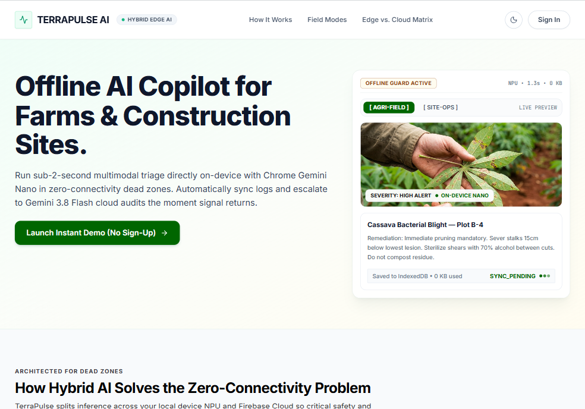

# TerraPulse AI

🔗 Live Demo: https://terrapulse-ai-gamma.vercel.app/



TerraPulse AI is a Hybrid Edge + Cloud AI copilot and installable Progressive Web App (PWA) for field diagnostics across agriculture (`Agri-Field`) and civil construction (`Site-Ops`). It runs sub-2-second text and multimodal triage locally on-device using Chrome Built-in AI (`Gemini Nano`) in zero-connectivity environments, then synchronizes queued logs and escalates to Gemini cloud models via Firebase AI Logic when network signal returns.

---

## Hybrid Edge + Cloud Architecture

TerraPulse AI separates inference and persistence into three layers so field operations continue without network access and automatically upgrade when connectivity is restored:

1. **On-Device Edge Triage (`Gemini Nano` / Chrome Prompt API):**
   - Text-only triage and offline chats run via Firebase AI Logic (`InferenceMode.PREFER_ON_DEVICE` online, `InferenceMode.ONLY_ON_DEVICE` offline) with a direct `window.LanguageModel` fallback (`session.destroy()` in `finally`) if the SDK initialization stalls offline.
   - Local prompts are capped to a 550-character budget with plain-text labeled streaming (`ACTIONABLE`, `TITLE`, `SEVERITY`, `CONFIDENCE`, `SUMMARY`, `ACTION`, `TAGS`) to avoid low-tier GPU lockups from constrained JSON decoding on-device.
   - When offline with an attached image (compressed to `512px` JPEG at `0.65` quality), the engine probes `LanguageModel.availability` for multimodal input; if the device reports `unavailable`, it completes text-only triage locally and flags the log for a Cloud Vision Deep Audit upon reconnect.

2. **Cloud Multimodal, Structured Audits & Live Voice (`firebase/ai`):**
   - Online multimodal triage (image, audio, video) routes directly to `InferenceMode.ONLY_IN_CLOUD` using `gemini-3.8-flash` with an ordered fallback chain: `gemini-3.8-flash` -> `gemini-3.5-flash-lite` -> `gemini-2.5-flash`.
   - Deep Audits (`/logs/[id]`) and Multi-Log Weekly Synthesis (`/synthesis`) invoke Firebase AI Logic Server Prompt Templates (`getTemplateGenerativeModel` for `agri-*` and `site-*` template IDs) with direct `Schema`-enforced JSON fallback (`rootCauseAnalysis`, `stepByStepPlan`, `estimatedMaterialsOrInputs`, `safetyOrComplianceNotes`, `workflowSteps`).
   - Natural Cloud Persona TTS uses `gemini-2.5-flash-preview-tts` (`ResponseModality.AUDIO`, `Aoede` voice for `agri` and `Fenrir` for `construction`, with PCM-to-WAV header wrapping).
   - Real-time bidirectional voice sessions in Quick Chat attempt `getLiveGenerativeModel` with `gemini-3.1-flash-live-preview` (`ResponseModality.AUDIO`, 16 kHz PCM microphone streaming), falling back to turn-based voice dictation and `generatePersonaSpeech` if unavailable.

3. **Offline Persistence & Sync (Firestore + PWA Service Worker):**
   - Firestore is initialized with `persistentLocalCache` and `persistentMultipleTabManager` (`src/lib/firebase/config.ts`), persisting field logs, base64 images, and audit queues in IndexedDB.
   - Online/offline state is tracked via `window` `online`/`offline` events, `navigator.connection`, and a periodic probe to `https://www.gstatic.com/generate_204`, plus an optional simulated-offline toggle in the header.
   - Production builds register `public/sw.js` (`terrapulse-shell-v2`) via `src/components/PwaRegistrar.tsx` to precache `/`, `/dashboard`, `/logs`, `/synthesis`, `/settings`, `/manifest.webmanifest`, and `/icon.svg`, while bypassing cross-origin Firebase API hosts so IndexedDB handles data sync cleanly.

### Where Firebase AI Logic Runs in Code

- `src/lib/firebase/config.ts` — Initializes the Firebase AI Logic singleton via `getAI(firebaseApp, { backend: new GoogleAIBackend() })` after App Check initialization.
- `src/lib/ai/hybridEngine.ts` — Calls `getGenerativeModel` at runtime across `InferenceMode.ONLY_ON_DEVICE`, `InferenceMode.PREFER_ON_DEVICE`, and `InferenceMode.ONLY_IN_CLOUD` for field triage, chat, and persona voice synthesis.
- `src/lib/ai/hybridEngine.ts` — Invokes `getTemplateGenerativeModel` for server-managed `agri-*` and `site-*` Deep Audits and Weekly Synthesis reports.
- `src/lib/ai/hybridEngine.ts` — Establishes real-time bidirectional audio sessions via `getLiveGenerativeModel` (`gemini-3.1-flash-live-preview`).

---

## Core Features

- **Role-Based Workspaces & Mandatory Onboarding:** Authenticated accounts complete `/onboarding` to assign a locked operational role (`Agri-Field` for crop/livestock diagnostics or `Site-Ops` for structural/safety triage) and active field zone (`users/{uid}.zone`), mirrored to `localStorage` (`terrapulse_cached_user`) for offline cold-starts.
- **Multimodal Triage & Structured Output:** Accepts text, 512px compressed photos, text/CSV/JSON documents, audio recordings, and short video clips (`<= 8 MB`). Parses results into structured severity, confidence, summary, immediate action, tags, and cloud audit checklists. All interactive forms and action triggers are locked inside `<fieldset disabled={...}>` while async inference or auth requests are active.
- **Dual Communication Modes (`Chat Options`):**
  - **Quick Chat:** Multi-turn conversational assistant (plus contextual follow-up chat inside `/logs/[id]`) that does not create Firestore `FieldLog` records until the operator clicks **Save Conversation as Field Log**.
  - **Voice-to-Text, Record Voice, Voice Loop & Live Mic:** Continuous dictation into the editor without premature pause-submit, client-side Web Audio `AnalyserNode` RMS silence detection to prevent blank audio logs, and online Gemini Live / Cloud Persona TTS playback.
- **Installable Offline PWA:** Web app manifest (`src/app/manifest.ts`), production-only service worker caching, session-persisted observation drafts (`terrapulse_draft_observation`), and sanitized user-facing error handling (`src/lib/utils/errorMessages.ts`).

---

## Tech Stack

| Layer | Technology / Package | Version (`package.json`) |
| :--- | :--- | :--- |
| Framework | Next.js (App Router, `output: "standalone"`, Turbopack) | `16.4.6` |
| UI Runtime | React / React DOM | `19.3.0` |
| Language | TypeScript | `^5` |
| Styling | Tailwind CSS / `@tailwindcss/turbopack` | `4.3.3` |
| Icons & Theme | `lucide-react`, `next-themes`, `clsx`, `tailwind-merge`, `class-variance-authority` | `^1.76.0`, `^0.4.6`, `^2.1.1`, `^3.7.0`, `^0.7.1` |
| Backend & AI SDK | Firebase Web SDK (Auth, Firestore, App Check, Remote Config, Firebase AI Logic `firebase/ai`) | `^13.4.0` |
| On-Device Edge AI | Chrome Built-in AI (`Gemini Nano` / `window.LanguageModel`) | Chrome 139+ |
| Linting | ESLint / `eslint-config-next` | `^9` / `16.4.6` |
| Containerization | Docker multi-stage build (`node:20-alpine`), Docker Compose | Node 20 |

---

## Engineering Challenges & Technical Solutions

### 1. Cloud Timeouts, High-Demand Errors & Connectivity Dropouts
- **Problem:** Client-side timeouts caused valid cloud multimodal/audit responses to abort under slow rural links, while HTTP `500`/`503`/`429` high-demand spikes left logs stuck in `"processing"`. On-device `firebase/ai` calls could also stall when Chrome's local model did not support image inputs.
- **Solution:** Removed artificial client-side timeouts from all online cloud requests (`runFieldTriage`, `runCloudDeepAudit`, `runWeeklySynthesis`, `streamFieldAssistantChat`, `generatePersonaSpeech`). Implemented `runCloudWithFallbackChain` across `["gemini-3.8-flash", "gemini-3.5-flash-lite", "gemini-2.5-flash"]` with immediate retry on retryable errors, and reset `cloudAuditStatus` in Firestore to `"queued_offline"` or `"failed"` on final failure. Offline image triage checks `LanguageModel.availability` explicitly and degrades to text-only Nano plus a queued Cloud Vision audit when local vision is unsupported.

### 2. App Check & Live WebSocket Authentication
- **Problem:** Standard `generateContent` REST calls can succeed when App Check is unenforced, whereas `getLiveGenerativeModel` enforces App Check strictly on the WebSocket handshake. Next.js Fast Refresh also risked re-initializing App Check or leaving `getAI()` bound to an unattached app instance.
- **Solution:** Refactored `src/lib/firebase/config.ts` so `firebaseApp` is a strict top-level singleton, `self.FIREBASE_APPCHECK_DEBUG_TOKEN` is set on `localhost` before `initializeAppCheck(firebaseApp, { provider, isTokenAutoRefreshEnabled: true })` (persisted on `self.__TERRAPULSE_APP_CHECK__` against HMR), and the exported `ai` singleton is created only after App Check initializes. `startGeminiLiveVoiceSession` fetches a valid App Check token before `liveModel.connect()` and falls back quietly to turn-based voice capture if restricted networks block the WebSocket handshake.

### 3. Model Deprecation, Prompt Echo & Schema Enforcement
- **Problem:** Older `gemini-2.0-*` endpoints were deprecated, and concatenating formatting instructions into the user prompt caused small on-device models to echo or hallucinate field issues on casual greetings like `"Hello"`.
- **Solution:** Migrated cloud defaults to `gemini-3.8-flash` (with `gemini-3.5-flash-lite` and `gemini-2.5-flash` fallbacks) and `gemini-3.1-flash-live-preview` for Live Audio. Enforced `Schema.object(...)` JSON responses for cloud Deep Audits and Weekly Synthesis, moved all triage behavioral rules strictly into `systemInstruction`, and added `isActionableFieldIssue` classification plus a client-side greeting guard so non-issues route to Quick Chat instead of creating false Firestore logs.

---

## Local & Docker Setup

### Prerequisites
- Node.js `20+` and `npm`
- A Firebase project with Authentication (Email/Password, Google, Anonymous), Cloud Firestore, Firebase AI Logic (Gemini Developer API), Remote Config, and App Check enabled
- Optional for on-device offline AI: Chrome 139+ with Prompt API (`Gemini Nano`) enabled

### 1. Environment Configuration (`.env.local`)

Create `.env.local` in the project root with placeholder values replaced by your Firebase project credentials (all `process.env.*` keys referenced in `src/`):

```env
# Firebase Web SDK (required)
NEXT_PUBLIC_FIREBASE_API_KEY=your_firebase_api_key
NEXT_PUBLIC_FIREBASE_AUTH_DOMAIN=your-project-id.firebaseapp.com
NEXT_PUBLIC_FIREBASE_PROJECT_ID=your-project-id
NEXT_PUBLIC_FIREBASE_STORAGE_BUCKET=your-project-id.firebasestorage.app
NEXT_PUBLIC_FIREBASE_MESSAGING_SENDER_ID=123456789012
NEXT_PUBLIC_FIREBASE_APP_ID=1:123456789012:web:abcdef1234567890

# Firebase App Check (provide at least one reCAPTCHA site key for production)
NEXT_PUBLIC_RECAPTCHA_SITE_KEY=your_recaptcha_v3_site_key
NEXT_PUBLIC_RECAPTCHA_V3_SITE_KEY=your_recaptcha_v3_site_key
NEXT_PUBLIC_RECAPTCHA_ENTERPRISE_SITE_KEY=

# Optional: fixed debug token UUID for localhost App Check testing (defaults to true in dev)
NEXT_PUBLIC_FIREBASE_APPCHECK_DEBUG_TOKEN=
```

### 2. Local Development

```bash
git clone <YOUR_REPO_URL>
cd terrapulse-ai
npm install
npm run dev
```

Available npm scripts (`package.json`):
- `npm run dev` — Start Next.js development server at `http://localhost:3000`
- `npm run build` — Build standalone production bundle
- `npm run start` — Start production server
- `npm run lint` — Run ESLint (`eslint-config-next` 16.4.6)

### 3. Docker Production Build & Run

Build the multi-stage `node:20-alpine` standalone image with your public Firebase build arguments:

```bash
docker build \
  --build-arg NEXT_PUBLIC_FIREBASE_API_KEY=your_firebase_api_key \
  --build-arg NEXT_PUBLIC_FIREBASE_AUTH_DOMAIN=your-project-id.firebaseapp.com \
  --build-arg NEXT_PUBLIC_FIREBASE_PROJECT_ID=your-project-id \
  --build-arg NEXT_PUBLIC_FIREBASE_STORAGE_BUCKET=your-project-id.firebasestorage.app \
  --build-arg NEXT_PUBLIC_FIREBASE_MESSAGING_SENDER_ID=123456789012 \
  --build-arg NEXT_PUBLIC_FIREBASE_APP_ID=1:123456789012:web:abcdef1234567890 \
  --build-arg NEXT_PUBLIC_RECAPTCHA_SITE_KEY=your_recaptcha_v3_site_key \
  -t terrapulse-ai:latest .
```

Run the container:

```bash
docker run --rm -p 3000:3000 --env-file .env.local terrapulse-ai:latest
```

Or run with Docker Compose:

```bash
docker compose --env-file .env.local up --build
```
